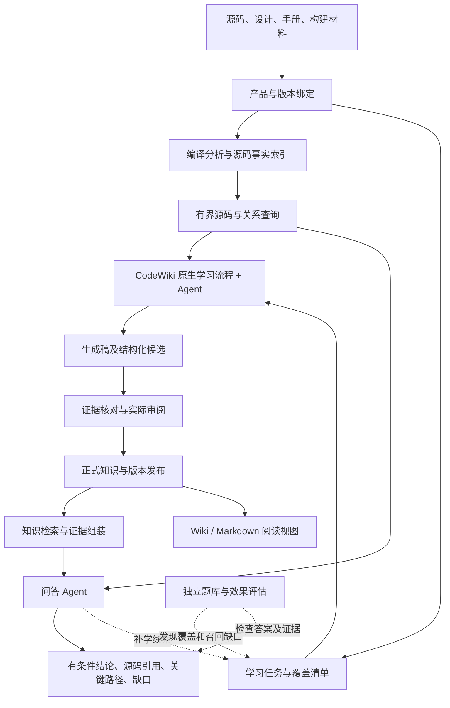

# 源码知识工程目标架构

日期：2026-11-07。本文是当前目标架构，实施顺序见[效果试点计划](plans/knowledge-effectiveness-pilot-20261107.md)。已有能力与待完成部分分别列出；本文不是全流程或 500 万行 C++ 的验收报告。

工程收敛为：固定版本的 CodeWiki 承担学习流水线，现有 Agent 承担研究与问答，本仓保留数据库专题、版本证据、编译事实访问、知识审阅发布及效果评估。CodeWiki 是第一实施候选，是否扩大采用由 openGauss 实测决定。RAGFlow、独立门户及自训练检索器不进入首期必需依赖。

## 1. 系统边界与数据流

图中是职责模块，不是必须分别部署的微服务。初期保持两个运行位置：Linux 产品构建环境负责产图；Windows 或 Linux 学习端保存知识并提供 Agent 工具。查询服务与图文件放在同一主机，通过已有 MCP/HTTP 按需返回数据。当前 Windows 只读挂接与本地 HTTP 已有实现；另一台 Linux 主机上的完整学习部署仍须实测。

## 2. 七个模块及复用边界

| 模块 | 职责与输入输出 | 复用和待补 |
| --- | --- | --- |
| 材料与版本管理 | 固定产品、源码快照、设计/手册、工具链、构建配置及实际索引 run，保留排除项和缺失项 | 复用 `store.py`、`study.py` 及当前材料冻结；试点需重新核对配套关系 |
| 源码事实服务 | 由编译命令生成配置下的符号和关系；提供符号定位、邻接、源码片段和能力说明 | 复用 ECS GCC/Clang 产图、`query_api.py`、`gateway.py`；不同前端能力不混称 |
| 学习任务与覆盖管理 | 决定学哪个模块/机制、为什么学、用哪些输入、交付及遗漏是什么 | 复用现有任务登记/租约；接入 CodeWiki 模块树与执行记录，不另写模块聚类算法 |
| 学习执行 | 原生分析、模块划分、依赖顺序、文档生成与更新；按需研究数据库专题 | 复用 CodeWiki MCP 和宿主 Agent；修正旧适配脚本对 baseline、模块树和特定页面的假设 |
| 知识审阅与发布 | 将候选变成有身份、有条件、有来源的知识，保留实际审阅类型及历史 | 复用 `knowledge.py`、`publication.py`；补生成稿到结构化候选的通用映射 |
| 检索与回答 | 同版知识定位、完整证据组装、缺口补读源码、回答及来源标注 | 复用本地检索和 MCP，使用已有 Agent；真实领域效果待验证 |
| 评测与变更维护 | 独立覆盖分母、证据召回、答案评分、变更失效与重学 | 保留当前评测检查及增量机制，补源码金标、真实问答记录和跨两套产物的失效验证 |

CodeWiki 的模块树、生成顺序、生成状态由上游管理。本仓顶层任务只管理研究范围、输入绑定、候选交接和审阅发布。一个顶层任务可以指向一个 CodeWiki run；不把其每个内部步骤再登记成另一套互相竞争的任务状态机。

原生生成目录由 CodeWiki 写，交接后候选按摘要冻结；正式知识由本仓知识流程写。不能由两个系统同时修改正式知识。旧工作区保持原合同，试点另建工作区，避免把历史知识无审阅迁入新流程。

## 3. 学习任务是明确的工程模块

任务不是临时聊天提示。任务记录至少包含：产品/快照/profile、范围、需要解释的机制、可用设计和手册、证据入口、专题义务、依赖、预算、执行器版本、检查点、候选产物、未覆盖项和审阅状态。

初次学习按以下流程执行：

1. 从文件、编译单元、注册表、文档和测试材料形成范围清单；尚未分析的材料必须可见。
2. 调用 CodeWiki 原生分析，由 Agent 使用上游提示和工具形成模块树、处理顺序。首次运行不应强制已有 Wiki 或手工预设树。
3. 按模块/机制开展研究，公共机制通过知识引用复用。错误、内存、兼容、GUC 是研究视角；按实际涉及情况登记 required / not_involved / unknown，不要求每个函数机械生成四篇文档。
4. 保存原生生成稿、实际读取记录与执行回执；据此提交结构化候选。格式和引用检查不能代替语义核对。
5. 经实际审阅发布。发现新依赖或缺口时生成有来源的补学任务，不能直接把任务标为完整。

覆盖清单应区分：未调查、已发现待学习、候选已生成、已核对、待补证据、随变化待复核，以及有依据的不适用。CodeWiki 组件已分配、文件已解析或页面已生成，都不是特性已学完。

“全量特性”只能相对于声明的源码范围、配置和盘点分母报告。可枚举的注册项、错误点、配置消费者等单列覆盖；复杂机制继续记录发现依据和未知项。不能由生成器自己的目录证明全仓语义闭合。

## 4. 数据怎么保存，调用链放在哪里

| 数据 | 权威存储与用途 | 与其他数据的关系 |
| --- | --- | --- |
| 原始材料 | 源码 checkout、冻结材料和摘要清单 | 所有事实和结论的可回读依据 |
| 源码事实图 | 已有封存 SQLite，按 snapshot/profile/run 只读访问 | 保存实际采集的符号和有来源的关系，不复制到每个任务或向量库 |
| 生成工作区 | CodeWiki 模块树、原生页面、元数据、运行记录 | 是学习过程及候选，不能等同正式知识；关闭上游会话前保留需要的交接材料 |
| 正式知识 | 本地知识 SQLite、结构化对象与私有知识 Git 修订 | 保存机制解释、条件、来源、相关路径、知识依赖和审阅记录 |
| 检索和阅读输出 | 发布清单、本地检索索引、Markdown/HTML | 从指定知识修订生成，可重建，不能独立成为另一份事实来源 |
| 评测资料 | 绑定源版本的题库、必要证据、原始答案、评分和运行记录 | 独立于生成知识目录；内部源码资料放私有工作区 |

因此确实需要在 Wiki 之外保留调用关系。源码图存已采集的邻接关系；知识单元保存解释某项机制所需的有限路径；Wiki 展示其中对阅读有用的部分。不会预计算并存下所有可能调用链。

关系须区分直接调用、候选调用、数据传递、状态迁移及异步阶段。直接静态调用也不代表某次运行必然走到。函数指针、虚调用、宏和注册表导致的不确定性保留在来源和解析状态中；不能把多个候选拼成唯一真实执行链。

每条机制知识的目标内容包括：稳定身份、所属模块与特性、适用产品/版本、构建和运行条件、实现行为、关键路径、相关契约、专题细节、反例/边界、源码/文档引用、尚缺证据、审阅身份及失效依赖。既有 claim / contract / mechanism / flow 等类型继续使用，不把所有解释塞成一个超长 Markdown 块。

父模块页只承担导航和概述。关键条件留在可单独检索的机制、契约及专题内容中，避免在逐层摘要时只剩概括。一个错误码可能对应多个检测点；一个内存上下文也可能服务多条生命周期，不能按名称简单合并。

## 5. compile_commands、宏和大索引

`compile_commands.json` 是编译分析的输入，不是交给大模型阅读的一篇知识文档。它提供具体 TU 的编译参数；分析还依赖真实工具链、包含目录、生成材料和环境。输入不完整时记录诊断与覆盖缺口。

既有 GCC/Clang 分析器在对应配置下提取事实。本机 GCC 路径目前主要交付 calls；Clang full 路径提供更多关系。保留宏位置或编译参数，不等于已经拥有完整宏关系图。接口须公开实际前端能力及失败 TU。

一套编译命令只解释已采集的构建配置。未启用宏分支可先通过源码/语法分析发现候选；要确认另一真实构建下的绑定，需要该配置证据。若原图缺决定性关系，安排有界补索引；没有条件执行时保留未知，不能由文本名称补成已确认关系。GUC 的运行值及兼容模式另作行为条件，不能用编译 profile 代替。

5 GB 等量级索引作为共享只读数据保留。查询先定位符号，再按关系种类、方向、页数、时间和返回字节预算展开；返回截断和未解析说明。每个任务只读取自己的证据片段，不传输全图，也不把每条调用边做一次 embedding。真实容量、峰值内存、并发和增量成本仍须在目标仓测量。

CodeWiki 原生 C++ 图用于模块发现和阅读导航，它的 Tree-sitter/启发式结果不能自动升级为编译事实。增加源码查询工具也不代表替换了上游分析器；上游自身的分析耗时、内存和大型文件遗漏需要单独验收。若必须重写其核心分析、规划或状态管理才能满足试点，就记录不适用并比较下一候选。

## 6. 问答和有效召回

问答使用当前项目绑定的产品、源码版本及发布；跨版本比较须显式保留两侧来源。流程如下：

1. 把问题拆成需要解释的对象和条件，例如机制、错误点、资源所有权、配置来源和消费者。
2. 从正式知识按名称、符号、错误码、参数名及文本检索，扩展相关契约和机制；初期使用已有词法检索基线。
3. 组装结论、适用条件、边界、相关契约及源码引用的完整证据组，不能只取一个听起来相近的摘要。
4. 发现必要证据缺口时，用同版源码和有界关系查询继续核对。知识命中率与这一步的补读成本分别记录。
5. 回答列明结论、条件、关键路径、引用和无法确认之处。已有审阅知识与本次临时源码推导分开标注；后者先作为补学候选，不直接写入正式知识。

源码补读可以让当前问题得到更完整回答，但不能掩盖知识库没学到的内容。评测同时保存“只用发布知识是否足够”和“补读后是否答对”。

如真实失败集中在自然语言到符号的匹配，再接入现成 embedding/reranker，与词法和精确符号检索比较；如果事实未学到，增加向量库不能修复。Code Comprehensor 的专门检索训练只是后续候选，当前没有实现 CodeContrast，也不预设需要训练。

## 7. 变更、版本与恢复

增量输入包括源码、公共头、构建宏/编译参数、生成材料、设计手册、专题方法及执行器版本。根据实际依赖判定受影响知识；无法安全判定时扩大复核范围。仅靠 Git 中 `.cpp` 的变化列表不够。

上游负责自身模块文档的增量处理；本仓负责材料绑定、正式知识依赖、适用性与新发布。两者通过显式 run 和产物摘要交接。原生文档更新成功，不代表已审知识自动有效；必须完成对应候选核对和新修订。

新发布准备、同步完成后才激活；查询全程固定 release_id 及其 source/profile/index_run。原发布保持可回读和可回滚。旧知识仍可适用于旧版本，但不能在新版本中静默继续使用。新版本覆盖减少时须公开缺口。

任务中断按本次冻结输入恢复，输入变化则新建 run。模型回执、工具失败、预算耗尽、解析失败与未覆盖范围留存。SQLite 采用受控写入，源图只读；不因图较大就立即引入另一套分布式图数据库。

## 8. 效果评估就是架构中的模块

先从原始源码和材料定义问题、条件及必要证据，再检查知识和答案；不能要求所有金标知识已经存在于发布集中。当前 `evaluation.py` 的已有知识 ID 检查保留，用于已发布知识召回验收；另增加独立机制覆盖评估，未入库的重要知识也计为缺口。

首轮按[试点计划](plans/knowledge-effectiveness-pilot-20261107.md)准备候选 80 题，按机制组分开发/封存两组。未获独立人工核定的答案注明候选，不假称专家金标。相同模型、源码工具和预算比较：直接读源码；增加原生 CodeWiki 文档；增加已核对数据库专题知识。此比较评估知识增益，不冒称复现某产品排行榜。

分别统计范围覆盖、必要证据召回、引用支持度、条件与机制正确性、无依据问题处理、生成成本、查询成本和增量失效情况。宏配置混用、错误内存生命周期等严重错误逐案失败，不能被平均分掩盖。盲测发现问题后的修订要使用新验收样本，不能反复调同一封存集并仍称盲测。

先排序，再跨模块，最后全仓容量和目标 GaussDB；小样本结果不代表 500 万行全量验收。当前 source_only：软件检查、源码推导、人工审阅、数据库运行验证分别记账。

## 9. 交付、仓库和迁移

工程代码、锁定的上游版本、适配器、方法、接口、样例配置和评测模板由本仓 Git 承载。真实内部源码、巨型索引、含源码的问答记录和知识包保存在独立私有工作区；知识修订使用已有私有 Git。迁移包列明依赖、版本、摘要、可复现命令和当前限制。

最终交付包括：可运行的学习与问答入口；模块/特性/机制知识包；错误、内存、兼容、GUC 查询视图；源图与关键路径查询；覆盖和待办清单；版本化知识发布及可选 Wiki；原始运行记录、效果报告和增量复核结果。

迁移到 GaussDB 时复用框架、方法、工具协议和评测流程，替换源码材料、产品适配、构建配置及索引，重新生成并核对产品知识。openGauss 的知识最多作为迁移线索，不能凭同名函数继承已验证状态。无需先改成依赖 RAGFlow 的架构。

## 10. 当前完成状态

| 状态 | 内容 |
| --- | --- |
| 已有实现 | 编译产图及只读挂接、材料绑定、任务租约、专题合同、知识审阅、版本发布、本地检索、有界源码查询、标准 MCP/HTTP、Wiki 导出 |
| 有旧接入，需要修正 | CodeWiki 执行适配及回执；首次学习、原生模块树产生和通用页面处理尚需完善 |
| 本轮确定、尚待落地验证 | 此架构的完整排序学习闭环，独立覆盖分母、三路真实问答比较、跨上游产物的变更复核 |
| 未证明 | 全量特性闭合、500 万行 C++ 语义效果、所有宏配置覆盖、GaussDB 迁移效果、专门训练的语义检索器 |

本文只修订设计和实施边界，不修改运行时代码，也不宣称新增模型实验已经完成。已实现代码及历史验证见[本地实现](LOCAL-PLATFORM.md)和[本地验收](LOCAL-VALIDATION-20261107.md)。

## 上游依据

- [CodeWiki 固定提交的 MCP 工作流](https://github.com/FSoft-AI4Code/CodeWiki/blob/a1b9f4acac4d3e1925c9d49e258b618741410540/guides/mcp-ide-mode.md)：宿主 Agent、分析与阅读工具、模块树、处理顺序、文档写入及会话元数据。
- [同一提交的增量流程](https://github.com/FSoft-AI4Code/CodeWiki/blob/a1b9f4acac4d3e1925c9d49e258b618741410540/guides/incremental-updates.md)：图差异、模块树修复、受影响模块更新及记录；不据此声称本仓已完成跨系统增量验收。
- [完整工程选型复核](plans/integrated-platform-audit-20261107.md)和[论文与效果证据](plans/deepwiki-effectiveness-evidence-20261107.md)：选型依据与适用范围。本文的数据库适配、发布和验收是本工程设计，不属于上游效果承诺。
