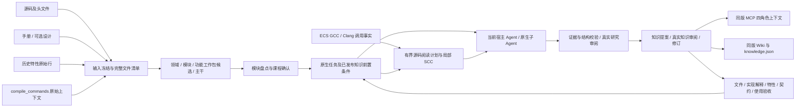

# 2.4 模块功能学习工程：实际实现设计

本版基于 [Code Comprehensor 复核设计](plans/module-feature-learning-redesign-20261108.md)落地。复用一套快照、原生 tasks、租约、研究审阅、知识提案和知识修订。课程与批次是这些状态的投影，不是第二个审批队列。

## 数据流与执行顺序

配置完成先得到整个源码仓的课程。函数、TU、图节点、SCC 成员和阅读区间不是全仓学习任务。用户选模块；模块范围审阅后即可深入，不等待所有模块盘点。

## 四输入、宏与版本

`project.settings/start` 接入 source/manual/features/compile_db，可选 design/index_db。`inputs.prepare` 支持 UTF-8 TXT/CSV/JSON 特性清单，保存原始行、行号/JSON pointer、稳定身份、别名、版本、模块提示、重复与歧义。输入名称只产生候选映射；mapped 必须有真实机制知识、来源交集和经过审阅的对应关系。

编译数据库保留全部原始命令、编译器、宏与头文件路径，支持显式 path_maps 和唯一安全后缀映射。未定位、歧义、无效、重复上下文分别记账；同一文件的多个宏上下文不合并成一个“已编译事实”。本机 inventory CDB 仅用于清单，不替代 ECS 上原始 CDB。

Windows start 不执行编译命令，不解析 TU，不读取公司凭据，不下载源码。真正编译事实由现有 ECS GCC 插件或 Clang 程序产生，带快照、profile、run、诊断和解析覆盖。原生生产端和跨 TU 绑定继续沿用既有实现，未因论文组件名称改成来源不明的同名 CodeGraph 产品。

所有 C++ 文件独立于编译图进入覆盖清单。未启用宏、没有调用者、间接回调和图外文件保留阅读义务。源码解释与编译器证明分开，原设计动机缺失保持未知。

文件/手册/头文件变化用 start --refresh 固定新快照；特性/CDB 内容变化进入输入指纹并触发重新绑定。旧知识保留原修订，不能自动按新构建使用。现有 2.3.1 记录不回填批准；2.4 的课程策略带独立协议指纹。

## 课程与责任田

| 层 | 数据和责任 |
| --- | --- |
| L1 领域 | 适配器中的能力/责任域候选，无法归类明确 unclassified |
| L2 子系统 | 源码与适配器提供的子系统导航；组织责任需由团队确认 |
| L3 模块 | 稳定源码范围、负责人/工作单、完整资产盘点、独立成员包 |
| L4 机制 / 功能工作包 | 用户可选择的行为问题，连接特性、主干、消费者与知识 |

责任树和特性树仍为两套 typed knowledge 节点，各自 level/parent；文件、函数、字段、宏作为实现与证据，不新增“函数级特性层”。目录范围不是已经批准的组织责任。

`curriculum.py` 按模块、行为名称候选和测试主题生成课程，默认每包最多 24 文件、240KB 原文；单个大文件保留在机制包内按区间续读。初始分组明确 candidate_requires_source_review，不能声称通过关键词发现了完整功能真相。Agent 盘点后用 refine + expected_revision 调整具体机制，必须保留全部文件，已执行范围不可悄悄重写。课程调整不批准知识。

公共机制和跨域主干沿用 10 + 12 项策略模板与原生任务。模板路径没有命中时生成范围调查；没有证据不得判 not_applicable。特性映射、主干任务与跨模块契约另有覆盖要求。

## 代码阅读及语义覆盖

`context_builder.build` 返回有界、只读的阅读计划，包含已审前置知识、冻结源文件、额外依赖证据、局部图来源及截断。NetworkX 对局部图缩并 SCC，再以 callee-first 后序给出阅读分组；保留环内全部成员、内部边和跨边。代表点不替代其他成员，图截断不消除源码义务。无图时直接沿冻结源码阅读，不生成“推理调用事实”。

`implementation.py` 为每个 CPP 建 200 行物理区间和宏/类型提示。它是保守的文本遗漏账，**不是完整 AST、逐函数语义图或静态分析证明**。区间永远不单独变成任务。

每个 explained 记录必须有 behavior/conditions/state/consumers/cleanup/test_basis、具体未知、实质机制知识 ID、完整区间引用，以及本次租约的实际阅读。纯 module/feature 标签不够。研究审阅后先 pending_knowledge；只有对应知识发布、内容哈希相同且版本适用才计 explained。有未知保持 explained_with_gaps，不能计闭合。合法空文件通过确切原文 SHA 和审阅记 no_implementation；不可读文件继续阻断，不能虚构解释。区间划分对同一程序不可变，调整 region_lines 需新工作区。

当前课程的 open 问题进入经审 progress.gaps，按模块机制归并补学；不再每个 coverage.open 自动生成一个任务。来源不明的旧队列不自动丢弃已领取工作。软件回归覆盖了这一防膨胀规则。

机器检查不能判断解释的全部语义真伪。审核者必须对照真实代码检查；测试、读取回执、页数及通过 JSON 校验均不代替语义审阅。

## 子 Agent、调度与多人汇总

`dispatch.py` 只分配原生任务。父会话选一个或多个模块，batch 返回独立 child session/worker、私有租约及 context_command；当前宿主的 Agent 工具运行研究。有效 token 不进入 prompt/输出。子代理不再建批次，不切换供应商/认证，不自动审阅自身结果。

批次锁防止重复派发，实际 Agent ID 用 attach 记录。重启只返回 resume_candidates，不为同一有效租约再启动一次。到期认领新 attempt 并重新读证据。父与子合计受并发和待审上限约束。关闭批次只释放本批仍拥有的有效租约，待审结果继续保留。

就绪任务优先继续机制与公共前置知识，同阶段 FIFO；不会把全部 module_survey 永远排在深入研究之前。范围前置要求完整盘点报告；知识前置要求实际发布且适用。调度、直接 claim、重认领、远程 receive 均执行该门槛。

跨服务器复用签名 workkit/result/feedback。模块课程、实现项、必要的已审前置知识和映射进入模块包，完整全仓图只在协调端挂接。结果保留真实子代理身份，并由工作单签名绑定主负责人、快照、原生任务完整范围。协调端复核后入库。未知续学范围不自动接纳；先协调端 advance 再反馈同步。成员本地改课程需协调，避免悄悄改写原工作单。

## Agent 知识与 MCP

| 角色 | 必需内容 |
| --- | --- |
| coding | 行为、条件、实现证据、接口/状态、消费者 |
| test_generation | 行为、预期来源、输入/状态/边界维度、实现证据 |
| review | 行为、条件、不变量、消费者、实现证据 |
| operations | 条件、可区分观测、诊断证据、配置/生效、条件措施 |

四角色从同一已审修订获取不同排序及结构字段。没有实际内容返回 partial/missing_required，不从标题制造测试 oracle 或运维处置；手册引用不能冒充实现证据，专题 open 项不冒充已确认事实。源码不涉及的项需要给出有依据的适用边界，不能填空泛套话。

MCP 新增 learning_inputs、compile_contexts、learning_curriculum、implementation_items、task_read_plan、refine_curriculum、learning_batch；既有 get_context 默认绑定当前工作区并支持 module/feature/mainline 选择器。查询角色不能改课程/派任务。compile_contexts 按模块/文件分页返回宏声明，避免每次把完整 CDB 放入模型上下文。stdio MCP 无需额外模型 SDK；高级外网网关继续是可选组件。

Wiki 的 knowledge.json、模块/特性/主干导航、四角色 JSON/Markdown/HTML 均来自同一 published revision。SQLite 保存权威状态，Wiki 不复制另一套事实。

## 论文借鉴与适用界限

采用论文的分层上下文、依赖阅读、逐层综合与 MCP 接口思路；不是完整复现其 CodeContrast 训练或全部 CodeGraph 实现。当前查询继续使用可核验的 FTS/词法基线与 typed knowledge；未宣称训练了专用检索模型。CodeWiki 的可选方法适配不成为必须部署的另一套状态，也不引入内网默认公网渲染服务。

覆盖验收同时检查全文件、CPP 解释、历史特性、主干、两端契约、未决项及四角色实际内容。最终学习覆盖、模型事实准确性与数据库运行验证分开报告。
