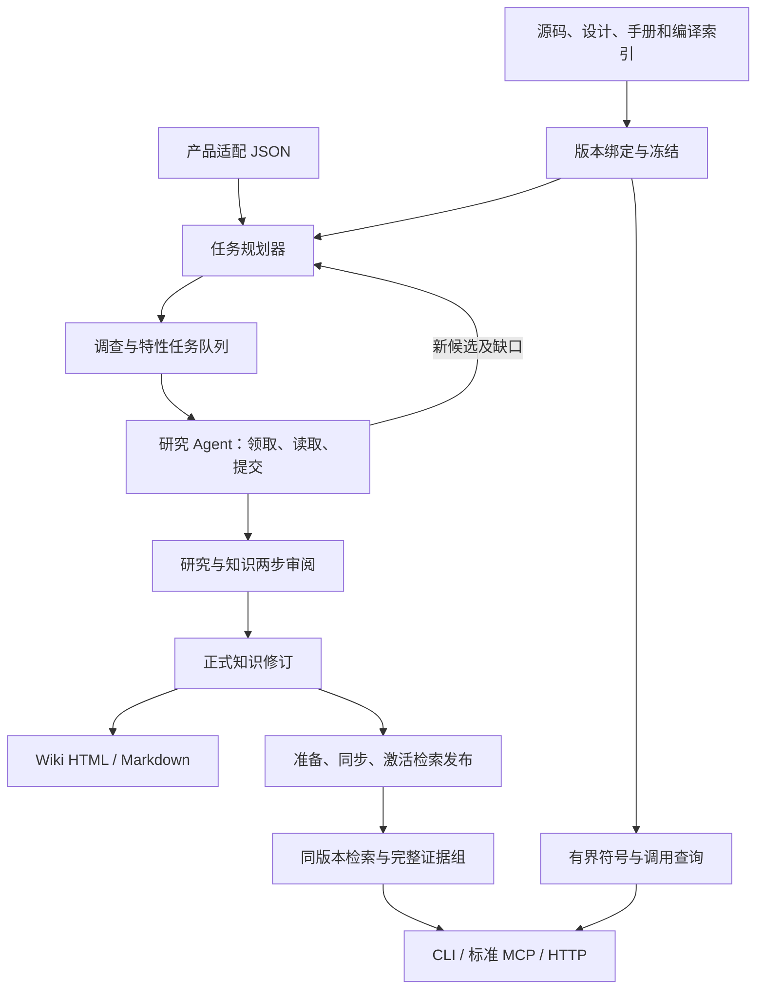

# 本地知识工程：实现与运行

本版以本地工作区为默认运行方式。源码索引、知识、任务和审阅不依赖 RAGFlow；研究推理由连接研究 MCP 的 Agent 执行。没有接入模型时也能运行规划、任务管理、审阅协议、知识检索、源码查询、Wiki 导出和软件验收。候选不自动升级为正式知识。

## 架构与实际代码



| 职责 | 实现 |
| --- | --- |
| 产品规则与模块归属 | `scripts/unified_knowledge/product_adapter.py`，`adapters/products/*.json` |
| 全仓盘点和候选 | `study.py`、`catalog.py` |
| 自动任务批次、反馈、去重与依赖 | `task_planning.py`，复用 `planner.py` 的任务/租约/审阅 |
| 正式知识与证据 | `knowledge.py`、`store.py`、`reader_wiki.py` |
| 版本化检索发布、恢复和回滚 | `publication.py` |
| 本地检索、可选 RAGFlow、证据组 | `retrieval_pipeline.py`、`ragflow_provider.py` |
| 分页源码查询与标准 HTTP MCP | `query_api.py`、`gateway.py` |
| 题库隔离和召回验收 | `evaluation.py` |

源码事实仍放在封存 SQLite。工作区通过只读引用访问已有图，不将 5 GB 图复制进每个任务或模型上下文。正式知识由知识引擎维护；Wiki 和检索发布是带身份的输出。知识修订另有私有 `wiki.git`；工程代码由本仓库 Git 管理。

## 依赖

使用 Python 3.12 与 Git。既有 `install.ps1` / `install.sh` 安装核心离线依赖。标准 HTTP MCP 和 RAGFlow 客户端的扩展依赖固定在 `requirements-platform.lock`：

```powershell
.\.venv\Scripts\python.exe -m pip install -r requirements-platform.lock
.\.venv\Scripts\python.exe -m pip check
```

安装命令可通过公司的 pip 镜像执行。发布包包含扩展锁文件，现有核心离线 wheel 包不含这些扩展；扩展的离线安装尚未验收。生产编译器及其环境仍由产图端提供。

## 从源码开始学习

复制 `paths.example.json` 到 `local/paths.json`，填写源码、设计/手册、工作区和可选 `index_db` / `run_id`。openGauss 同时设置 `"product": "openGauss"` 和 `"product_adapter": "opengauss"`，分别声明产品身份和规则包。切换 GaussDB 时设置真实产品身份，选择 `gaussdb` 或自己的适配 JSON 路径。适配器包含模块规则、注册和专题线索探测器；内置 GaussDB 配置是迁移起点，并未证明内部产品语义。

```powershell
.\kb.cmd check
.\kb.cmd start
.\kb.cmd modules
.\kb.cmd features --limit 30
.\kb.cmd plan-tasks --max-tasks 20
.\kb.cmd plan-tasks --max-tasks 20 --apply
```

`start` 自动建模块调查单；`plan-tasks` 预览当前候选任务，`--apply` 才入队。相同候选不会重复建单；每批受数量和初始文件预算限制。任务中有版本、问题、证据种子、专题适用性待判项、产物与验收要求。一个词法命中只能成为线索，不能直接证明兼容分支生效或内存所有权。

研究 Agent 连接 `start` 返回的 `researcher.mcp.json`，使用 `next_tasks` → `claim_task` → `task_context` → `read_task_evidence` / `create_task_evidence` → `stage_research_unit` → `finish_research`。研究新机制时用 `planning_feedback` 返回有来源的候选，随后调用 `plan_tasks` 生成下一批。CLI 对应 `planning-feedback --input proposal.json`。任务不会自行调用未知模型服务，也不会自动审阅自己。

反馈格式：

```json
{
  "study_plan": "<study_plan 返回的真实计划 ID>",
  "author": "<真实研究者>",
  "reason": "调查入口与清理路径后发现独立机制",
  "candidates": [{
    "title": "<行为名称>",
    "question": "<需要确认的机制与边界>",
    "reason": "<建单依据>",
    "owner_module": "<modules 中的完整模块名>",
    "evidence": [{"asset": "<冻结资产 key>", "start": 1, "end": 10}],
    "depends_on": [],
    "supersedes": []
  }]
}
```

合并/拆分用 `supersedes` 和新候选表达；已经进行或接受的研究保持历史记录。研究与知识两步审阅沿用 README 的 `review` 流程，实际审阅者和 `self_reviewed` / `independent_review` 分开记录。缺失证据、源码换版或编译配置未知均不能自动当成已完成。

## 发布与查询

下面的 `R`、`OLD` 是命令实际返回的发布 ID，`local/workspace` 是 `paths.json` 中的 `home`。默认 provider 是本地 FTS/词法基线，未使用语义 Embedding 模型。

```powershell
.\kb.cmd platform --home local/workspace manifest
.\kb.cmd platform --home local/workspace prepare
.\kb.cmd platform --home local/workspace sync --release R
.\kb.cmd platform --home local/workspace activate --release R
.\kb.cmd platform --home local/workspace query --release R --question "排序使用哪些内存上下文？"
.\kb.cmd wiki
```

只有已审知识可以准备发布。同步完成才允许激活。新版本使用 `activate --release R --expected-active OLD`；回滚时把旧版本作为目标并填当前版本。一个问题的检索、知识回读和证据组装固定同一发布；客户端后续调用须携带返回的 `release_id`。

上下文按完整证据组装入：结论、条件、反例、相关契约和引用源码一起返回；预算不足则明确省略整个组。`no_answer` 表示没有完整适用证据，不自动补造答案。代码图仍通过 `lookup_symbols` 和 `graph_neighbors` 按需读取，旧图的未经确认绑定保留 candidate。

## 本地 HTTP 与 Agent 入口

```powershell
.\kb.cmd platform --home local/workspace serve --host 127.0.0.1 --port 8766
```

- MCP：`http://127.0.0.1:8766/mcp`，官方 MCP Python SDK 1.30.0 的 Streamable HTTP。
- HTTP：`POST /api/context`，JSON 为 `{"question":"…","release_id":"R"}`。
- 证据页面：上下文中的 `/evidence/<ID>?release_id=R` 链接。
- 查询端不开放建单、提交或审阅。研究继续走现有 researcher 入口。

默认监听回环地址。远程部署使用 `--token-env KB_GATEWAY_TOKEN`，配合公司现有网关/TLS；`--allow-release R` 可限制发布范围。源码引用页面与 MCP 使用同一访问规则。

## 可选 RAGFlow

本地默认路径不启动 RAGFlow。后续准备好服务和模型后，填写 `integrations/ragflow/provider.example.json`，密钥放在其 `api_key_env` 指定的环境变量，再执行 `prepare --provider <配置文件>`。同步按独立发布知识集、确定性文件名和元数据恢复；核对导出字节、解析完成和模型配置后才可激活。

客户端依据 [RAGFlow v1.0.0 API](https://github.com/infiniflow/ragflow/blob/v1.0.0/docs/references/http_api_reference.md) 实现，已有协议测试；本机没有运行其服务，不能将测试替代真实 RAGFlow 效果验收。网关复用 [官方 MCP SDK](https://github.com/modelcontextprotocol/python-sdk/tree/v1.30.0)，已做官方客户端与真实本地 HTTP 服务互通。

## 可重复验收

```powershell
.\.venv\Scripts\python.exe -X utf8 -m unittest discover -s tests
.\.venv\Scripts\python.exe -X utf8 scripts/verify_local_platform.py --output local/acceptance-new
.\.venv\Scripts\python.exe -X utf8 scripts/benchmark_source_gateway.py --home <真实学习库> --output local/gateway-benchmark.json
```

验收脚本要求新的输出目录。它运行合成源码的双成员研究/审阅/Wiki 流程，再验证检索发布、证据组和无答案处理；报告明确不属于 openGauss/GaussDB 语义或模型准确率证明。真实索引脚本只读回放具体符号，单列版本、并发、预热条件、响应大小和延迟。

实际领域题库使用 `knowledge-evaluation/v1`，绑定发布 ID、mechanism group、development/acceptance split 和可接受的必要知识集合。工具拒绝同机制跨调参与验收集泄漏。召回指标、证据完整率、回答语义正确率和数据库运行验证分别记录。

## 交付边界

本地工程可以独立运行并通过软件流程验收。有效召回还取决于已审知识范围与真实题库；新建的空工作区不会因索引完成而自动获得产品理解。openGauss 方法及引擎可迁移；GaussDB 的适配规则、真实工具链和行为结论需要目标源码验收。当前不宣称全仓特性闭合、200 题真实语义验收完成或数据库运行验证通过。

本次实际执行记录见[本地验收报告](LOCAL-VALIDATION-20261107.md)。验收生成的 Wiki 使用合成 C++ 样例展示流程，不是完成了 openGauss 排序知识研究的证明。
