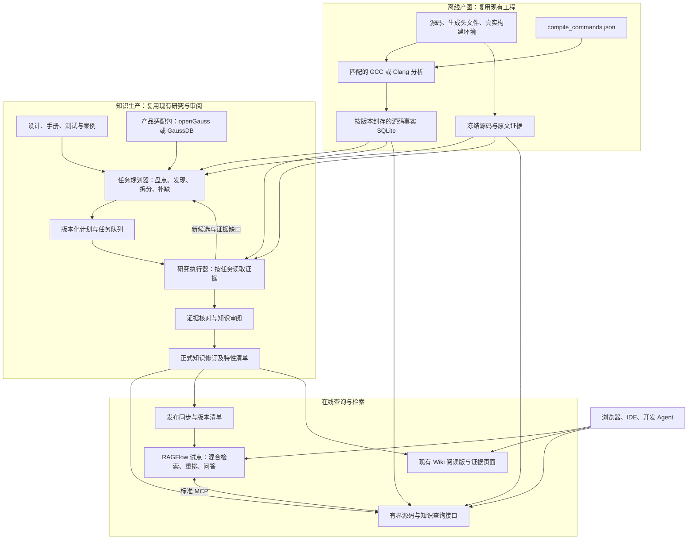

# GaussDB 源码知识库落地设计与交付计划

日期：2026-11-07。状态：工程设计稿；本轮完成现有能力和对接接口核验，未部署新的知识平台或远程查询服务。目标为集中式 GaussDB、约 500 万行 C++；已有源码、构建环境及 openGauss 编译数据库索引试验。

## 1. 实施基线

**复用现有 GCC/Clang 产图与 SQLite 交付、现有知识研究和审阅流程；补齐有界查询及标准远程接口；以 RAGFlow 作为首个检索问答集成试点。** RAGFlow 接入验收通过后才转为生产依赖，不将接口文档核验等同于实际效果证明。

不重新开发通用 C++ 解析器、图数据库、向量引擎或问答前端。第一版不迁移到 CodeGraphContext/Neo4j，不同时部署多套 RAG 产品。新索引器留作具体精度或维护问题的对照，不作为使用已有索引的前置条件。

规划假设：同一个内网团队使用，Linux/ECS 可运行服务，已有或可以接入公司模型服务，Windows 通过浏览器或开发 Agent 使用。模型、Embedding、Rerank 的具体 ID 在接入时锁定并实测，不预设需要购买 GPU、训练模型或发送源码到外部服务。

新增实现落在现有 `gaussdb-source-knowledge` 主仓；`database-source-knowledge` 中的方法与已有研究文档作为可追溯输入。已有知识工作区保留原版本身份，避免两套业务入口分别演进。这里新增的是设计和任务清单，不代表已经迁移已有项目。

## 2. 现有资产与真实起点

| 能力 | 已核实的现状 | 计划中的处理 |
| --- | --- | --- |
| 编译数据库与产图 | openGauss 2,412 个上下文；新版 GCC 全部 parsed，32 分 9.701 秒，交付图 5.171 GiB | 直接作为现有产图基线，保留真实工具链；公司 500 万行另做输入核验 |
| 本地历史图 | 4.914 GiB，旧 Clang run 为 partial | 可查询、可做回归；不能升级描述为全量干净解析 |
| 图的使用 | 已有只读挂接；学习库不重复存 symbols/relations | 在图所在主机查询，客户端按需取结果 |
| 有界查询 | ExecSort 一跳实查 26 个节点、30 条边，预热后单次约 3.2 ms | 只是局部样本；需补分页、字段投影、字节预算和并发验证 |
| 返回大小 | 原始响应 121,024 字节；本轮字段投影演示 19,654 字节 | 演示尚未变成正式接口；完整上下文和诊断改为按需读取 |
| 知识生产 | 模块/特性候选、任务、证据、审阅、知识修订及 Wiki 导出已有实现 | 复用流程，逐模块形成正式知识，不按每条调用边建任务 |
| 本地检索 | FTS5 与 lexical-hash 基线；外部向量路径仍存在逐条遍历 | 保留为离线对照，不作为大规模语义检索生产方案 |
| 服务接口 | 已有 stdio MCP 与 loopback HTTP；后者不是 Streamable HTTP MCP | 使用官方 MCP SDK 增加标准传输，调用现有查询逻辑 |
| 宏/字段 | GCC calls 模式有部分拼写和展开位置；没有完整宏关系、字段读写图 | 按能力明确返回范围，关键机制先定向补证，完整导出另行验证 |

证据：[2.2 ECS 报告](../benchmarks/opengauss-2412-v22.md)、[已有索引使用核验](D:/lxm/AI现网处理/database-source-knowledge/references/existing-opengauss-index-use-20261107.md)、[只读查询回执](D:/lxm/AI现网处理/artifacts/opengauss-index-reuse-20261107/readonly-probe.json)。ECS 源码没有可核实 Git HEAD，现有试验依靠源码文件与编译库摘要绑定；不能填入其他 checkout 的 commit。

## 3. 总体架构



这张图表示职责，不要求每个框都部署一个新服务。运行时主要是现有工程的查询/知识服务、RAGFlow 官方部署栈和现有模型服务；研究 worker 是批处理执行者。RAGFlow 官方栈本身包含其数据库、检索引擎等依赖，不是单个容器。

### 3.1 各部分的边界

- **编译数据库**：索引生成、增量失效判断、特定 TU 补充分析的输入；不作为日常问答的文档语料。
- **源码事实索引**：符号、调用、位置、构建上下文、解析状态和证据身份；由现有 SQLite 保存，不全部转换成向量。
- **任务规划器**：读取绑定材料、产品规则及研究回执，构建模块目录、候选特性和有界研究任务；复用现有任务数据库，具体能力边界见 3.3。
- **正式知识库**：机制结论、条件、反例、跨模块契约、待确认项、测试预期和证据关系；现有知识引擎是权威来源。
- **RAGFlow 检索集**：正式知识和适用文档的可重建检索副本；不成为第二个独立编辑的知识母库。
- **Wiki**：正式知识的阅读视图、特性目录和专题导航。第一版复用现有 HTML/Markdown，不新写一套门户。
- **查询接口**：将问题范围限制到正确版本，按需读代码图与原文，控制返回大小。代码关系不是实际运行 trace。

### 3.2 物理部署

Linux 构建环境继续负责生成索引，保持产品工具链及依赖完整。查询进程在能本地读取封存 SQLite 和源码 blob 的 Linux 主机运行；多个用户通过接口访问，避免把 SQLite 当作跨网络共享文件使用。

现有产图端支持 Python 3.9+，协调/知识端要求 Python 3.12；在 ECS 部署查询与知识服务时应使用独立环境，不改变产品构建工具链。Linux 协调端入口虽已存在，真实的集中部署全流程仍要在 P0/P1 核验。

RAGFlow 应用与其检索依赖可放在同机或另一台内网应用主机，取决于资源实测。首期不要求 Kubernetes。构建任务与问答服务若共机，限制构建并发并避开使用高峰，观察 CPU、内存、IO 和查询延迟后决定是否拆机。

Windows 作为浏览器/Agent 客户端，不需要每人复制整份 5 GB 图。无法联网的研究成员保留离线任务包方式，但要增加包预算、范围说明和追加材料机制。公司模型服务按统一接口接入，生产查询默认只读。

现有 ECS 的 16 逻辑 CPU、约 30.3 GiB RAM 只验证了产图任务，不证明同机运行 RAGFlow、模型和并发问答仍有足够资源。容量按实际测量规划；存储应计入活动图、保留版本、构建暂存、源码 blob、检索索引和备份，不能只看单个交付 SQLite。

### 3.3 任务规划器与产品适配

任务构建是知识生产引擎中的独立逻辑模块，职责是把“学习这个代码库”变成可执行、可恢复、可验收的任务。第一版在现有 Python 工程内实现，继续使用现有 SQLite 任务与依赖表，不额外部署任务微服务。规划器负责决定研究范围与缺口，执行器负责取证、研究和提交；结论接受仍由审阅流程负责。

**已存在的代码基础与尚未实现的边界：**

| 环节 | 当前实现 | 迁移前需补齐 |
| --- | --- | --- |
| 项目绑定 | `project.py` 支持源码、文档、索引、product/revision、module_prefixes 配置 | 独立的产品适配包身份、版本摘要及校验 |
| 模块盘点 | `study.inventory` 根据路径/前缀分组，创建 `module_survey`，保存计划和缺口 | 多目录组成一个逻辑模块、共享机制归属、产品规则外置；当前默认路径仍含 gausskernel 等约定 |
| 候选发现 | `catalog.discover` 识别文档、GUC 注册、Stmt 语法规则和测试 SQL | 探测器接口；错误/内存/兼容等线索；无显式注册的内部机制发现与覆盖复核 |
| 特性建单 | `study.focus` / `ecs.focus_existing` 按明确选择创建 `feature_research`；同一计划内候选重复选择复用任务 | 模型辅助的归并/拆分提案、限定预算的批量建单、专题适用性和跨模块依赖生成 |
| 持久化与执行 | `planner.create_task` 保存任务及依赖；已有领取、证据读取、提交和审阅 | 规划决策记录、研究缺口回流建单、循环/重复扩展控制和换版重规划 |

当前候选探测器是写在代码里的启发式规则，不能宣称已经完成 GaussDB 自动特性规划，也不能把候选数量当成全量特性数。现有 `planner.py` 的任务机制继续复用，不用文件名来证明高层语义规划已经完备。

**通用引擎与产品适配包分开：**

- 通用引擎：版本绑定、资产盘点、候选登记、任务拆分/合并、依赖校验、去重、预算、任务状态、覆盖统计和审阅接口。
- 产品适配包：模块归属与别名、入口/注册规则、GUC 结构、错误报告宏、内存上下文 API、兼容分支、测试/文档位置，以及构建 profile 的对应关系。简单约定用配置，复杂识别用探测器插件。
- 产品材料：每个产品独立的源码快照、生成文件、真实编译 profile、索引、文档和已有审阅知识。openGauss 的研究方法和模板可复用；行为结论、符号和证据必须在 GaussDB 重新绑定、核实。

迁移目标是换产品绑定和适配包，保持通用规划、任务执行、审阅及检索合同不变。不能预先保证 GaussDB 的编译器/宏形式均已支持；真实工具链差异仍需索引接入验证，缺失能力必须形成缺口。

**规划过程：**

1. 冻结输入身份与适配包版本，读取索引能力清单；规划时按模块、有界查询，不加载整张调用图到模型。
2. 盘点所有纳入范围的源码、文档和测试，生成初始模块归属；无法归属的资产保留为缺口。
3. 用规则产生候选线索，再在有界模块内用研究模型补充内部机制、合并重复候选和提出拆分。每项保留来源及理由；无证据的模型猜测只能成为待核线索。
4. 将确认研究边界的候选转成任务。错误、内存、兼容、GUC 先判定 required / not_involved / unknown，共享机制用关联任务复用，不机械地为每个函数乘四建单。
5. 按依赖和预算生成可领取队列；执行中发现新特性、跨模块消费者、未解析调用或未覆盖宏分支，通过结构化回执追加、合并或退回任务。设置每轮扩展上限与停止原因，防止不断自建任务。
6. 材料、profile 或规则变化后重规划，保留旧计划。受影响知识进入待复核；不能仅凭名称一致继承已接受状态。

任务合同在现有 snapshot/run/profile、kind、bundle、dependencies 上增补：产品/适配包摘要、候选及模块身份、研究问题、边界与入口、证据种子、专题适用性、预期输出、验收项、预算和建单理由。任务只携带引用与有限上下文，执行器通过现有接口继续取证。已有实现尚未包含这些全部字段。

计划的权威状态继续保存在现有工作区数据库；`plan.json` / `PLAN.md` 是可查看的导出。补齐后还应导出候选处置表、任务依赖、覆盖与缺口及规划变更记录。计划 ID/重复判定需纳入源码、profile、适配包与规划策略版本；LLM 非确定输出采用已持久化提案回放，不能每次重跑静默生成不同任务。

**独立工作包 B13 的验收：**

- 同一输入和策略重复规划不重复建单；中断可恢复；依赖无环且能解释每个任务的建单依据。
- openGauss 排序清单由材料和规则产生，人工研究清单用于独立核对召回与误归并，不作为隐藏硬编码输入。内部机制漏发现仍计入规划缺口。
- 一次新增候选、研究反馈、公共头文件/宏变更及未知探测器规则均有可追踪结果；未知宏分支不能被判成“不涉及”。
- 产品规则调整不需要修改通用规划核心。除公开样例外，必须在真实 GaussDB 模块上复跑并由维护者核对；模拟目录换名只能验证接口，不能替代迁移验收。
- 规划覆盖与知识完成分开统计：有任务不等于学会，有候选不等于特性完整，文件已盘点不等于所有条件已验证。

## 4. 开源复用方案与集成门槛

| 职责 | 实施选择 | 需要增加的内容 |
| --- | --- | --- |
| 编译语义分析 | 已有匹配 GCC 插件/Clang 路径 | 目标工具链验证、能力清单、必要的局部补充分析 |
| 图持久化及查询 | 已有 SQLite 与 query_graph | 默认字段投影、分页、执行/返回预算；不另造图引擎 |
| 任务规划和知识审阅 | 已有 study/catalog/planner、提案、修订、证据机制 | 产品适配包、语义候选与有界建单、缺口回流、专题模板和实际内容审阅 |
| 文档/知识检索、重排、问答 UI | RAGFlow v1.0.0 文档/API 作为首个集成基线 | 发布同步、元数据过滤、同版证据关联与效果测试 |
| MCP 远程传输 | 官方 MCP Python SDK | 包装现有查询函数，锁兼容版本，不手写另一套协议 |
| 模型 | 公司已有模型服务优先 | 锁模型 ID、版本、上下文长度、计费/资源口径和提示词版本 |
| Wiki | 已有导出器及页面 | 增加稳定的同版源码证据链接与目录入口 |
| 评测 | 平台检索测试/API + 可重复运行的题库脚本 | 金标题目、必要证据集合、人工复核和失败归因 |

本轮已核对 RAGFlow 的 [外部 MCP](https://github.com/infiniflow/ragflow/blob/v1.0.0/docs/develop/mcp/connect_an_external_mcp_to_ragflow.md)、[元数据](https://github.com/infiniflow/ragflow/blob/v1.0.0/docs/guides/dataset/metadata_management.md)、[检索测试](https://github.com/infiniflow/ragflow/blob/v1.0.0/docs/guides/dataset/retrieval_testing.md) 和 [HTTP API](https://github.com/infiniflow/ragflow/blob/v1.0.0/docs/references/http_api_reference.md)。它接受 Streamable HTTP/SSE，不直接接受 stdio；内网服务还需要按文档配置允许的网络访问。官方 [MCP SDK](https://github.com/modelcontextprotocol/python-sdk) 提供传输能力，具体 SDK/协议版本必须与选定 RAGFlow 客户端联合测试，不能直接跟随 main 升级。

RAGFlow 的普通 retrieval API 中，`use_kg=true` 并不启用多跳图检索。源码调用图仍通过现有图查询工具访问。平台内的文档关系图不替代编译语义图。

RAGFlow 试点的通过条件是：版本过滤、知识 ID/内容哈希透传、引用回到正确源码、中文问题召回、MCP 调用与返回预算都能实际工作。若失败，先修配置和薄适配；只有明确无法满足核心合同才替换应用/检索层，已有事实图和正式知识不随之重建。

## 5. 统一版本与数据合同

### 5.1 发布清单

每次可供查询的知识版本使用一个 `release_id`，清单至少包含：

```json
{
  "release_id": "<待生成的不可变发布ID>",
  "product": "GaussDB-centralized",
  "source_snapshot": "<源码快照或可核实的Git提交及文件摘要>",
  "build_profile_digest": "<真实编译环境摘要>",
  "index_run": "<已封存的索引run>",
  "index_capabilities": ["<本次实际导出的事实种类>"],
  "knowledge_revision": "<已接受的知识修订>",
  "retrieval_dataset_ids": ["<发布时实际生成的知识集ID>"],
  "embedding_model": "<实际模型与版本>",
  "rerank_model": "<实际模型与版本>",
  "generation_model": "<实际问答模型与版本>",
  "retrieval_config_digest": "<检索与上下文配置摘要>",
  "method_pack_digest": "<研究方法与提示词版本摘要>",
  "evaluation_report": "<该发布的验收报告引用>"
}
```

这是规划的合同示意，不是已有发布数据。服务端将 release 映射到源码、run、知识和检索集，模型不自由拼接路径或选择不相容版本。一个问答会话固定 release；更新后新会话可选择新版本，历史会话继续可追溯。

GCC ABI 与 Clang USR 的身份空间不能直接互换。跨索引器或跨版本迁移知识时，重新绑定证据和符号；遇到歧义保留待核对，不凭同名函数继承批准状态。

### 5.2 知识条目

沿用现有 claim、mechanism、contract、feature、flow、test_obligation 等类型。每条包含稳定 ID、模块/特性、主题、正文、适用条件、反例/限制、源码引用及依赖、审阅身份和状态。源码引用包含快照、文件、内容 hash、行区间及必要的符号/调用点身份。

调用边、状态变化、数值传递、注册分派和运行观察分别建模。将“规划器产生值，执行器消费值”写成数据契约，不伪装成直接调用。错误码、内存上下文、兼容性和 GUC 的专业表格引用这些共同事实。

### 5.3 查询响应

在现有响应上补 `release_id`、查询范围、能力/覆盖说明、紧凑节点与关系、证据引用、未解析项、截断标记、下一页游标和预算消耗。默认不返回所有 TU contexts、完整诊断或重复的快照 JSON；需要时按身份展开。

数量、深度、时间、响应字节和模型 token 分别设上限。分页排序稳定；服务器在执行过程中限制开销，不能只在把大量数据读入内存后裁剪。硬截断时回答必须说明范围，不能把没返回的关系当作不存在。

## 6. 需要提供的查询接口

| 能力 | 复用基础 | 补齐要求 |
| --- | --- | --- |
| 发布与覆盖查询 | status、run/profile 清单 | 同时给出正式知识与图能力、允许访问的 release |
| 函数/宏/字段定位 | 符号索引、现有范围文本检索 | 精确身份优先；未导出的宏/字段返回文本线索及能力边界 |
| 上下游与路径 | query_graph、navigate_code、explain_path | 紧凑输出、分页、条件筛选、候选和未解析边可见 |
| 源码和文档证据 | read_evidence、冻结 blobs | 版本一致、hash 校验、行段预算、可在浏览器打开的证据 URL |
| 知识检索 | find_knowledge、现有版本约束 | 增加 RAGFlow 检索 provider；取回候选后按 ID/hash 回查权威知识 |
| 回答上下文 | get_context 与已有知识/证据关系 | 支持外部检索命中输入，保留必要证据组和条件，避免再独立重跑一套不同检索 |

普通问答端只开放只读工具。现有 `request_refresh` 会写入补学任务，不能因为它在当前 QUERY_TOOLS 中就作为普通只读能力开放；反馈/研究创建走单独的显式工作流。研究与审阅继续复用已有角色和入口。

新增服务使用公司已有访问网关/身份能力；先限制到授权的产品与 release，再检索和读取源码。第一版不开发自己的登录系统。MCP 网关和证据页面必须共享版本及访问范围。

## 7. 从源码到正式知识的生产流程

1. **接收和冻结**：核对源码、编译库、工具链、生成文件、图、设计和手册的身份；已有封存图直接挂接，不重复产图。
2. **建立全仓目录**：模块责任树、特性候选清单和图外资产均可见。候选来自入口、注册表、文档、语法、配置和测试；不把文件目录或调用条数当特性数量。
3. **按特性研究**：一个有边界的机制为单位，读取设计/手册、相关图和源码，记录正常路径、关键分支、跨模块生产/消费、异常清理与反例。
4. **核对四类专题**：错误、内存、兼容性、GUC 各自标注 required / not_involved / unknown，并说明理由。不是每个特性都强行填写四种关联。
5. **审阅后接受**：复用现有证据与提案审阅，程序验证引用和结构，模型/维护者核对语义；自审、模型复核和人工专家审阅分别记录。
6. **发布检索副本与 Wiki**：同一知识修订产生页面、结构化内容和检索输入，保持同一身份。

弱模型可承担候选整理、已有证据的初稿和格式化；关键调用绑定来自分析器，关键机制由更强的研究/复核能力及模块维护者核对。任何模型生成的草稿都不会自动成为正式知识。

“全量特性”首先要求范围可对账：所有已发现特性都有状态、证据和责任归属。状态至少区分已发现、待研究、研究中、已审、待复核、明确不涉及。页面同时显示已审比例和开放缺口，不把目录覆盖率当成语义完成率。动态行为和未覆盖配置仍要显式列出。

## 8. 首个模块如何落地

排序模块用于完成一次真实闭环，不再只做静态页面样例：

- 绑定一份明确的 openGauss 源码快照和编译 profile，优先使用已完成的 GCC run；保留旧图作回归。
- 对已有特性清单逐项复核，并检查入口、普通/有界排序、外排、数据形态和计划/执行交互等是否确实属于本版本范围；不直接复制另一源码版本的清单。
- 对每项确认算法阶段、调用路径、状态/数据传递、错误点、内存归属、GUC 消费和兼容条件；非适用项有依据。
- 选出 work_mem/算子内存/并行度、上下文创建与清理、错误传播、排序比较语义等问题，制作必要证据集合。
- 将同一知识修订接入问答、Wiki 和 Agent 上下文，验证能回到同版源码。

这份 ECS 试验源码含 `GetAvailRackMemory` 等不同于早先公开 Git checkout 的内容，必须按当前快照研究。SQL 和运行案例在当前 source_only 范围仍标为 not_run，不借用结构索引成功作为行为通过证明。

排序完成后再做第二个结构不同的模块，以检查方案不是针对排序硬编码。具体从错误处理、内存上下文或另一个高价值执行模块中按实际需求选择，不扩大为一次性全仓自动总结。

## 9. 宏与复杂 C++ 的专项处理

宏信息分为：定义与条件、使用位置、实际展开来源、展开后调用/访问以及未激活分支。优先使用真实编译上下文和现有位置映射；不按名字把所有 `palloc` 或 `Assert` 合成一个对象。

每个 release 明确事实能力。例如当前 GCC calls 可提供调用及部分宏位置，不宣称有完整展开轨迹、字段读写或所有条件分支。`work_mem` / `SET_NODEMEM` 不在 calls 符号表时，用绑定源码补证，并标明该证据类型。

首期针对数据库常见的错误、断言、内存分配、控制流和表达式宏建立专项金标。若关键问题必须依赖完整预处理导出，则单列补充采集试验；先在少量真实 TU 验证，再决定扩展现有 GCC 路径或采用成熟工具。Clang full 不能跳过此前已发现的 GCC 兼容门槛。

完整宏展开不是“字符串替换”。嵌套、重复求值、字符串化、token 拼接、重定义和 include 环境必须保留来源。函数指针、方法表和模板解析不充分时保留候选；不能为追求完整调用链让模型补造目标。

编译条件与运行条件分开：`#ifdef` 属于构建覆盖；SQL 兼容模式、会话 GUC、输入类型和执行计划属于运行时条件。不为每个 GUC 数值重新建图，也不把多个编译配置的边无条件并集。

## 10. 在线问题如何得到答案

1. 客户端选择产品/版本/构建配置，服务端固定 release 与允许查询的知识集。
2. 参数名、错误码、函数名先走精确/词法定位；自然语言机制问题走 RAGFlow 混合检索和重排。两种召回可以联合，但共享版本约束。
3. 检索命中携带知识 ID、内容 hash 和证据身份，回查正式知识。正式知识与原始手册/设计保留不同来源标签，冲突时不自动以一方覆盖另一方。
4. 从知识条目或定位结果选择少量相关符号，按问题查询上下游、宏相关源码和消费者，而不是固定展开所有两跳邻居。
5. 组装模型上下文。一个结论所需的条件和证据作为一组保留；命中但在裁剪时丢失关键证据，必须计入失败。
6. 生成带依据的回答；来源不足或能力未覆盖时明确待确认，可由用户发起补学任务。

浏览器可采用 RAGFlow 原生 Retrieval 节点加 MCP 证据工具；IDE/Agent 通过同一查询服务使用 RAGFlow retrieval API。两条路径共用发布映射、provider 参数和证据组装逻辑，避免网页与 Agent 使用不同知识版本或两套排序规则。

第一期进入 RAGFlow 的是正式知识条目、适用的设计/手册及必要原文片段。全仓源码仍可经符号索引与现有范围文本检索定位；不把全部 250 万条 CALLS JSON 嵌入向量，也不重复嵌入预处理后的头文件展开。若源码文本搜索成为实测瓶颈，再复用成熟全文索引能力。

## 11. 同步、更新与回滚

### 11.1 发布同步

正式知识接受后，发布器按 `release + unit_id + content_hash` 幂等导出并调用平台 API。元数据由程序设置，至少包含版本、profile、模块、特性、专题、来源类型和审阅状态；不让 LLM 猜版本标签。

新知识集先处于 staging：等待解析和 embedding 完成，核对文档/条目 ID 与摘要、运行抽样检索和引用校验。图、源码、知识及检索集全部可用后，再切换一个发布清单入口。不存在跨 SQLite/RAGFlow 的原子事务，所以必须采用“先准备完整新版本，再切换引用”的方式。

第一期每个发布使用独立知识集或可严格隔离的命名空间，绑定明确的助手/工作流配置。旧会话仍引用旧 release，不修改其引用对象。同步失败、重试或重复执行不会重复生成正式条目；旧发布继续可用。

平台内的正式知识集由发布器维护，修订回到权威知识库，不同时在平台 UI 和原库维护两份正文。RAGFlow 的检索参数测试结果还需同步到实际 Agent/Chat 配置，不能以测试页通过代替线上配置通过。

### 11.2 源码或配置变化

源码、头文件、生成文件和编译参数变化先计算受影响 TU；缓存是否可用仍采用现有严格判定。不能证明缓存安全的情况重做对应分析，高扇出头文件可能触发大范围重建。

随后沿知识依赖把受影响结论标为待复核，定向研究并生成新知识修订。未受影响的内容可以复用，但需验证适用条件和证据身份。索引器变化导致身份空间变化时单独处理映射，不能只替换数据库路径。

新发布完成同样的验收后激活。回滚切回先前发布清单，保留新旧图、知识和检索集直到保留策略允许清理。初期只保留约定数量的活动与历史版本，具体数量由容量和审计要求决定。

## 12. 分阶段落地与角色

以下是工作量估计，不是已有完成状态。假设 2 名工程人员持续投入，另有数据库模块维护者参与内容研究与复核；模型服务、构建环境和内网访问已可用。可用试点基线约 4–6 周，包含排序闭环及目标库接入验证；**不代表 4–6 周审完 500 万行全部特性**。全仓知识生产周期应以首批特性的实际研究/复核吞吐量估计。

| 阶段 | 预计窗口 | 主要工作 | 明确交付与退出条件 |
| --- | --- | --- | --- |
| P0 输入与版本基线 | 1–2 个工作日 | 确认现有 GCC 图、源码、编译库、工具链、文档；梳理目标 GaussDB 组成 | 发布清单草案、能力/缺口表；现有索引可读取且来源相符 |
| P1 查询服务 | 3–5 个工作日 | 紧凑投影、分页和预算；官方 SDK 远程 MCP；源码证据链接 | 客户端按需查图和原文；无全图复制；版本/权限/截断回归通过 |
| P2 检索平台集成 | 3–5 个工作日，可与 P1 部分重叠 | 固定 RAGFlow 版本；模型接入；发布同步；检索 provider 和工作流 | 一份正式知识能幂等发布、召回、引用、回滚；MCP 实际互通 |
| P3 排序知识闭环 | 5–8 个工作日，与工程集成交叠 | 特性盘点、四专题、跨模块契约、知识审阅、问题金标 | 排序目录和已审知识可查询；开放项显式；通过模块题库 |
| P4 目标规模与更新验证 | 3–5 个工作日，风险时延长 | 公司 500 万行单一真实配置；并发、更新、宏样本、第二模块；冻结题库评测 | 覆盖、正确性、召回、成本与失败报告；不以 openGauss 代替目标库验收 |
| P5 发布与交接 | 2–3 个工作日 | 部署包、配置、恢复演练、监控和操作手册 | 独立环境按说明运行；发布/回滚/增量流程可重复 |
| 持续建设 | 按模块滚动 | 根据优先级补全特性和共享机制，吸收真实问题 | 每批有已审增量、覆盖变化及回归结果 |

角色分工：工程 A 负责图服务、编译/版本和增量；工程 B 负责平台、同步、检索和部署；数据库维护者负责语义边界、金标与关键知识接受。研究模型/Agent 可辅助执行，不能代替知识负责人的结论责任。实际人力不足或模型环境未就绪时调整排期，不降低验收口径。

B13 任务规划器产品适配作为 P1–P3 的显式工作包，由工程 A 与数据库维护者负责，在 P0 绑定资产后启动；排序正式闭环和目标库验收均依赖它。上述窗口是原基线，B13 的规则抽离、规划反馈和真实产品差异需在 P0 分解后重估，不能默认由原工期无成本吸收。

建议第一批实施顺序：P0 先绑定现有资产 → P1 让大图可远程有界查询并启动 B13 → P2 接通正式知识检索 → P3 通过任务规划器跑通真实排序问题 → P4 用公司目标库验收 → P5 交付。新增工作包见同目录的 `knowledge-platform-backlog-20261107.json`，全部是计划项。

## 13. 验收标准

### 13.1 必须满足的确定性条件

- 当前选定范围内的编译命令有逐项状态，没有隐蔽跳过、解析回退或错误吞没；例外和未覆盖分支进入报告。
- 关键样例中没有跨版本/配置拼接、同名符号错连、把候选当确定调用或引用错误源码。
- 所有输出证据链接可打开且与绑定内容 hash 一致；分页、预算或超时不被解释成“不存在”。
- 正式知识与平台检索副本版本相同，失败重试幂等；旧发布可回读和回滚。
- 问答只读；研究、审阅及发布各有明确入口和记录。

### 13.2 知识召回和回答

首批至少 200 题，建议 80 题用于调参、120 题封存验收；同机制的改写放在同一分组，防止变体泄漏。涵盖特性、调用、宏/构建、错误、内存、兼容性、GUC、跨模块和无答案问题，中文症状问法与精确标识符问法均包含。金标包含必要证据组，而不只是参考答案。

同模型、同预算比较四组：词法基线；混合检索/重排；增加代码关系；增加正式领域知识。记录 Recall@5/10/20、完整证据命中率、上下文保留、回答正确性、引用支持、拒答和成本。人工核对关键判定，不只让生成答案的模型自己打分。

建议初始准入目标：必要证据 Recall@20 ≥95%，最终上下文必要证据完整率 ≥90%，可回答题正确率 ≥90%，无答案题的正确处理率 ≥95%；关键版本/配置错误为 0。以上是待实测的工程目标，不是已有成绩；按专题分别报告分母和不确定性，不能用总平均掩盖内存或错误码题的失败。

特性清单要求 100% 的已发现项有处置状态，已审覆盖率单独统计；未审项不进入“已验证知识”的默认答案。源码研究与 SQL 运行验证分别记账。

### 13.3 性能与规模

先以固定测试主机、8 并发、暖缓存设置试验目标：精确符号查询 P95 ≤300 ms，有界一跳查询 P95 ≤1 s，文档检索/重排耗时单列。端到端模型耗时按实际模型、输出长度和服务负载测量，不用本地 3.2 ms 图查询推导问答延迟。

完整测量冷建、更新、峰值 RSS、临时与最终空间、索引失败、查询响应字节、上下文 token 和模型成本。普通源文件、公共头文件、编译宏、生成头文件至少各有一类更新样例；增量结果与同输入重新全建的规范化事实比较。是否使用更大服务器、只读副本或替换后端，依据这些结果决定。

## 14. 最终用户能使用什么

### 14.1 在线交付

1. **可提问的知识库**：浏览器搜索/问答；回答带适用范围、源码或文档依据、关键条件和待确认项。支持 IDE/Agent 使用同一版本的工具。
2. **模块与特性目录**：每个模块有哪些已发现特性、哪些已审、哪些待补；能按错误、内存、兼容性、GUC 查看交叉关联。
3. **源码证据入口**：从结论打开同版原文、函数上下游和必要的宏/条件解释；路径区分静态关系、候选和运行观察。
4. **Wiki 阅读版**：总览、模块、特性、共享机制、专题和测试预期；来自同一正式知识修订。
5. **维护入口**：现有 CLI/Agent 负责研究、审阅和发布；第一版不承诺所有管理操作都网页化。

例如排序模块的页面结构应为：模块范围与版本 → 特性清单及状态 → 每项机制/条件/调用与数据阶段 → 错误与清理 → 内存上下文 → GUC 和兼容性 → 源码证据 → 测试预期及未运行项。这是交付结构，不是本轮新增已审知识。

### 14.2 数据和工程交付

```text
release-<id>/
  release-manifest.json       # 源码、配置、图、知识、检索版本映射
  source-facts/               # 封存图、run 与能力/覆盖说明
  evidence/                   # 内容寻址源码/文档，或受控存储清单
  planning/                   # 产品适配包身份、计划/任务导出、覆盖缺口与规划回执
  knowledge/                 # 正式结构化知识与模块/特性目录
  wiki/                      # 可独立阅读的 HTML/Markdown
  evaluation/                # 题库、金标、实测结果与失败案例
  operations/                # 部署、同步、更新、备份、恢复及回滚手册
```

代码交付还包含锁版本的部署配置、镜像/离线依赖清单、MCP/API 合同、RAGFlow 工作流及检索配置、发布同步程序、评测命令与日志格式。代码和配置包不自动携带公司源码、模型凭据；内部数据包另行保存和分发。

工程验收时交付可独立复用的公开 openGauss 样例，再交付受控的 GaussDB 数据版本。源码事实、正式知识和检索副本均能按 release 追踪，替换检索平台时无需重新研究全部知识。

## 15. 已知风险与处理顺序

| 风险 | 处理 |
| --- | --- |
| 宏和字段事实未完整导出 | 明确能力边界，关键 TU 定向补证；必要时单列采集器增强，不伪装已有能力 |
| RAGFlow 原生界面无法完整展示源码证据 | 使用已有 Wiki/证据页面链接；先完成可追溯访问，不开发复杂新 UI |
| 元数据过滤或同步导致漏召回/串版 | 独立发布知识集、服务端版本映射、回查 ID/hash、故障和回滚测试 |
| 高扇出函数或公共头文件产生大结果 | 执行/返回预算、稳定分页、按问题选取；完整图保留在服务端 |
| 大模块离线包继续膨胀 | 在线按需读取优先；离线任务包增加硬预算和边界说明 |
| LLM 草稿看似完整但事实不足 | 必要证据组、专题金标、人工复核和显式未知；不按页数验收 |
| 全仓知识生产超出平台搭建周期 | 按实际模块/特性吞吐滚动排期；页面分别显示盘点、已审和运行验证覆盖 |

本次完成的是实施设计、接口核验和工作包规划。需要新增的任务规划器产品适配、远程网关、发布同步、平台集成、统一上下文预算和目标库验收均未被标记为完成。
