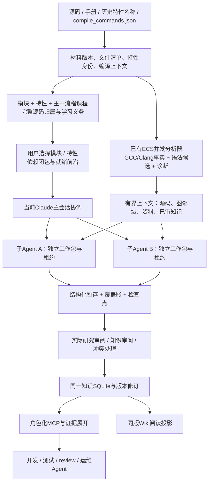

# 模块、特性与主干流程驱动的源码知识学习工程

日期：2026-11-08。审计基线：已发布2.3.1，提交`bc31a42b98fd064d00aebb4125a7e9471e96749b`。

**状态：研究结论与待实施设计。** 本文没有把新增输入、功能课程、子Agent调度或角色化输出当作当前已实现能力。现有SQLite、冻结证据、租约、审阅、知识修订和MCP继续复用；所有新工作包沿用一套任务状态，不再另造学习队列。

目标是：四种输入经过版本绑定，形成可解释、可选择、可并行推进的模块/功能学习计划；逐步建立全部源码的已审知识，通过MCP向开发、测试、review、运维Agent提供前置上下文。

## 1. 四项诉求及验收口径

| 需求 | 工程必须做到 | 验收证据 |
| --- | --- | --- |
| R1 四输入 | 接收源码、手册、历史特性名称、compile_commands.json；无设计文档可用 | 每种输入有摘要、来源、解析结果、缺口；特性清单逐行可对账；编译上下文与源码文件对应 |
| R2 功能课程与全量覆盖 | 用户管理模块/功能/特性/主干流程工作包；每个.cpp有归属和最终学习义务 | 逻辑计划与源码覆盖映射完整；函数/调用边/TU不成为全仓课程任务；不能凭读取回执判理解完成 |
| R3 Agent前置知识 | 同版知识服务开发、测试、review、运维；Wiki和数据库内容一致 | 四角色真实问题返回适用条件、关键机制、证据及缺口；角色要求不同；知识不足明确报告 |
| R4 指定模块并行学习 | 当前Claude会话可选择一个或多个模块，以原生subagent执行 | 不同子Agent有独立上下文/租约，范围受限；可续作，汇总冲突可见；不启动另一套Claude CLI驱动主流程 |

“全部.cpp都学习到”定义为声明源码范围内每个.cpp均有可核查的学习记录、机制映射和实际审阅，不以编译成功、全文读取、页数或一句摘要代替。项目还应学习相关.c/.cc/.cxx、头文件、SQL、注册与构建材料；`.cpp`单独报告分母。

构建配置集合必须明确。没有被本次编译选中的文件仍要学习，宏分支可以读源码并记录条件；未观测构建下的绑定不宣称已经编译验证。文件研究覆盖、行为问题闭合和运行测试通过分别计量。

## 2. Code Comprehensor复核：采用哪些思想

阅读版本为[Code Comprehensor v2](https://arxiv.org/html/2610.30016v2)。下表仅短述论文事实，右列为本工程独立设计。

| 原文方法 | 本工程的采用方式 |
| --- | --- |
| IV-A：Tree-sitter；NetworkX图；FastAPI遍历接口 | 保留已有GCC/Clang编译事实，补语法候选；SQLite持久化、按需取子图，NetworkX只处理有界工作集 |
| IV-B：目录/章节，DFS后序分块与逐层综合 | 模块/机制组织任务，在包内按依赖分块；先理解必要依赖再综合入口，保留跨边和循环 |
| IV-C：父、兄弟、模块上下文 | 知识对象显式连接上层职责、同层机制、共享依赖及消费者 |
| III：MCP协调文档、结构和检索 | 现有MCP补模块/特性入口、角色化上下文与证据展开 |
| IV-B增量；IV-E文码检索训练 | 源码/头文件/配置/材料变化定向复核；先验证现成检索基线，再决定专用训练 |

论文的CodeGraph是系统组件，原文没有提供一个可直接安装的同名行业产品。本次在论文、参考链接和有边界的作者/题名仓库检索中，未找到可验证的完整作者实现入口；不能据此宣称全球没有代码。其依赖绑定细节不足以替代我们的C++宏、重载与构建适用性核验。[原文IV-A](https://arxiv.org/html/2610.30016v2#S4.SS1)

零入度根/DFS不能单独担保所有.cpp、递归环、回调或未启用分支都已研究；这是本工程的覆盖设计判断。在线查询多Agent也不等于已经实现离线并行学习。检索/回答忠实度不等于Agent改码或测试正确率。[原文III](https://arxiv.org/html/2610.30016v2#S3)、[V-F](https://arxiv.org/html/2610.30016v2#S5.SS6)

## 3. 公开工程比较与技术选择

| 候选 | 已核查的可借鉴部分 | 采用决策 |
| --- | --- | --- |
| Code Comprehensor | 分层综合、结构上下文、文码检索组合 | 采用方法，不声称接入作者未核实发布的组件 |
| CodeWiki | MCP工具由现有IDE Agent推理，维护模块树、处理顺序和文档；有叶先父后的组织 | 可评估其聚类/提示模板适配；不把它的状态目录变成另一套权威学习状态，也不默认换掉编译事实 |
| RepoAgent | 仓库变更驱动的文档维护与并发思路；README定位Python文档工作流 | 参考增量组织，不作为400万行C++/宏语义的直接替代 |
| Clang/GCC与Tree-sitter | 真实编译上下文和语法发现各有用途 | 编译器确认与语法/启发式候选分级，不合并成同一可信度 |
| 现有SQLite/MCP | 已有任务、证据、修订、图挂接、查询、协作包 | 继续作为工程底座；优先补课程和知识内容，不先更换数据库 |

已读的主要上游资料：[CodeWiki MCP模式](https://github.com/FSoft-AI4Code/CodeWiki/blob/main/guides/mcp-ide-mode.md)、[开发流程](https://github.com/FSoft-AI4Code/CodeWiki/blob/main/guides/development.md)、[RepoAgent](https://github.com/OpenBMB/RepoAgent)、[Clang编译数据库规范](https://clang.llvm.org/docs/JSONCompilationDatabase.html)、[Claude原生subagent](https://code.claude.com/docs/en/sub-agents)。

CodeWiki资料本次读取的blob SHA：MCP指南`cbd41d7f3284854a5fcff7ada49ceb95f683e08a`；开发指南`4c88fb32194ef87f422e91471ec073361057de00`。这些是文档blob标识，不冒充锁定了整个上游代码提交。若采用其代码，另锁定完整仓库提交、依赖与许可并做C++覆盖验证。

其开发指南明确说明图表验证使用远程渲染服务。若采用该写入器，内网版需要关闭或替换为本地验证，不能默认依赖公网渲染；只评估聚类/提示模板不必引入这部分运行依赖。

## 4. 当前2.3.1的实际缺口

| 缺口 | 当前代码事实 | 需要改造 |
| --- | --- | --- |
| 特性清单未接入 | `project.py:64`白名单无特性清单；`catalog.py`主要从文档/注册/语法/测试发现线索 | 独立历史特性导入与稳定身份、归并、映射、未定位账 |
| 原始编译数据库未贯通高级入口 | `project.start`在`project.py:126`传`compile_db=None`；新session入口无对应参数 | 接通已有低层编译数据库能力与ECS产图，先纳入上下文，再按环境执行分析 |
| 目录骨架不等于功能课程 | `study.py:123-145`按模块目录与统一问题建盘点单 | 在盘点之上构建功能/特性/主干流程课程与实现映射 |
| 平坦大模块不受硬预算约束 | `whole.partition`无子目录即保留；coverage补学取`missing[:12]` | 模块身份稳定，内部工作包按行为/测试主题分组与上下文预算分页 |
| 全局调度压后深学 | `whole.py:509-510`按固定kind优先和task哈希选任务 | 选择范围、依赖前沿、解锁收益和老化，及时完成一个模块的闭环 |
| 并行子Agent未接入 | session只有一个active句柄；旧`continuation.run`串行且禁Agent/Task | 父运行/独立子句柄、受限委派、并发领取、汇总、失败恢复 |
| 四角色内容合同不足 | `get_context`主要验证/回显task角色，装同类上下文；验收只列三角色 | 角色专门的召回、排序、必需字段与不足判定，加入运维 |
| 语义覆盖还不充分 | 全区间引用＋已审单元是必要检查，不能解释全部内部机制 | 文件/实现区间/知识问题三个账，残余核对与实际角色题目 |
| 历史架构材料易混淆 | 早期CodeWiki目标文档与已发布原生执行路径并存 | 标明历史候选/当前实现/本提案，统一当前路线和状态说明 |

独立openGauss实测：15,213个Git文件；2,380个.cpp分布284个模块；全材料计划有535个模块盘点、10个公共机制、12个集成任务，共557个初始任务；3,371条原始线索。22个目录模块超过80项资产，最大1,625项；956项资产领域待定。额外手册仅1页，不等于完整官方手册。

94.244秒是材料冻结与计划生成时间，不是源码学习时间。557是初始骨架任务数，不能报告为最终学习总数。该轮没有任何已审知识，未运行产品或数据库。工作树的`.git`文件误记为1条source资源，也是需修正的元数据排除问题。

## 5. 一套底座、两种数据、三个层次



三个层次分别是：用户可选择的逻辑课程、包内的物理阅读/分析单元、供Agent消费的已审知识。函数、符号、TU和调用边属于物理事实与导航层，不一一生成用户任务。

两种数据分别是源码事实和已审知识。上游事实库兼容现有ECS的`knowledge.sqlite3`交付格式；学习工作区的同名文件保存任务、证据和知识。两者用途明确，MCP统一查询，完整图只挂接一份，子Agent不各自拷贝5GiB图。Wiki从知识修订派生。

## 6. 统一四输入

以下是**目标配置示例，features/compile_db等新增字段当前2.3.1尚不接受**；不能直接复制到旧版运行。

```json
{
  "product": "GaussDB",
  "product_adapter": "gaussdb",
  "source": "E:/GaussDB/source",
  "manual": "E:/corpus/manual",
  "features": "E:/corpus/features.csv",
  "compile_db": "E:/corpus/build/compile_commands.json",
  "home": "E:/knowledge/gaussdb"
}
```

`index_db/run_id/graph_storage`继续兼容，已有图可以复用。ECS执行位置/路径映射为可选环境配置，不把登录凭据写进特性清单或源码包。

### 6.1 历史特性名称

最简支持UTF-8一行一个名称，或CSV仅有`name`列。可选字段为外部ID、别名、版本、父级、模块提示、描述、状态。CSV/JSON/Markdown/TXT为首批格式；XLSX可加适配，不让它成为名字清单接入的门槛。

保留每一原始条目的来源行号、原名和外部身份；去重/更名保留别名和映射依据。名称相似不自动合并，也不推断同名功能已实现。每条最终有`mapped / ambiguous / not_located / duplicate`等处置及证据；`not_located`只表示尚未定位，不能证明功能不存在。

清单是已知能力入口，不是完整主干流程的边界。没有历史名称的启动、SQL请求、计划执行、事务结束、异常清理、恢复复制等流程，继续从源码入口、注册、状态生产消费、测试与架构材料发现。

### 6.2 手册

保留版本、章节、正文锚点与功能预期。HTML按正文提取，导航/页脚不当成产品功能；扫描PDF、CHM或提取失败显式列出需要的转换。手册描述映射到特性和实现证据后仍需核对，不自动等于已实现事实。

### 6.3 源码与编译上下文

源码清单为分母，编译数据库不能替代它。编译数据库同一文件可以有多个命令；还依赖正确工作目录、工具链、包含目录及生成材料。[Clang规范](https://clang.llvm.org/docs/JSONCompilationDatabase.html)

先正规化`directory/file/arguments`、路径映射和工具链信息，登记每个compilation_context及未进入该构建的源码。不同上下文/配置的符号和边不混成一条确定执行链。

本仓已有`ecs.sh build --source ... --compile-db ... --work ... --output ... --jobs ...`，应由统一入口说明并接通，不再要求用户另找产图工具。ECS分析和LLM学习是两个并行度参数、两类作业；TU不能变成学习任务。缺少实际编译环境时，保留待分析状态，规划和静态源码学习可继续，编译确认结论不能冒充完成。

## 7. 计划的四种关联对象

| 对象 | 作用 | 与源码关系 |
| --- | --- | --- |
| 责任模块 | 能力域→子系统→模块→机制/接口责任单元 | 每个.cpp有主责归属；相关消费者可以跨模块 |
| 功能特性 | 功能域→功能族→特性→行为与约束 | 一特性可多文件/多模块，一文件可支持多特性 |
| 主干流程 | 入口、阶段、状态、消费者、出口、异常/清理 | 独立于历史名称清单；有证据、配置和未知 |
| 学习工作包 | 用户要完成的问题和可交付知识 | 模块/功能范围＋特性/流程引用＋必要源码和前置知识 |

责任树和特性树不强制同构。目录是候选组织线索，主责和业务边界需要研究确认；不把文件搬来搬去代替实现映射。

### 7.1 计划生成算法

1. **登记分母**：固定四输入、全部C/C++/头/SQL/测试/构建资产、编译上下文；排除工具元数据并保留理由。
2. **构造模块候选**：目录、命名空间、构建目标、公共接口及已有图联系共同给边界；没有图的部分保留静态候选，不能消失。
3. **融合能力线索**：历史名字、手册正文、注册表、语法、配置消费者与回归测试关联；生成有依据的特性映射候选，未映射单列。
4. **补主干流程**：从入口、注册/回调、状态链和跨模块接口恢复实现主线，记录主责与消费模块集合。固定模板作为检查清单，不能替代源码发现。
5. **做受控课程规划**：宿主Agent读取模块摘要、映射候选及必要证据，提出基础概览、特性组/机制、主干集成、残余覆盖及验收工作包。初次不必把所有后续问题写死；计划版本保留范围义务和待细化区域。
6. **程序核验后保存**：每个.cpp有归属与至少一个学习义务；历史条目无静默丢失；任务依赖无悬空；过大的工作包有可续作分块策略；所有候选/未定范围可见。

程序验证范围和依赖，Agent负责提出语义分组，审阅者确认计划依据。不能让同一个生成器的自述成为“规划已覆盖全部机制”的唯一证据。

### 7.2 工作包内容

每包包含：稳定逻辑ID、计划修订、模块和特性/主干引用、要回答的问题、源码/手册范围、编译条件、依赖、上下文与时间预算、产物要求、覆盖义务、检查点和验收问题。执行任务ID继续绑定快照/run/profile；逻辑特性身份不随任务措辞变化而重建。

用户看到的计划至少列出：模块/工作包名称、学习目标、已知/待核特性、全部源码与.cpp数量、前置、是否就绪、预计工作量依据、交付物、未映射项和验收条件。需要细化的范围保留为义务，不用看似精确的固定总任务数掩盖未知。用户可以在开学前调整归并/分拆，计划修订保留历史。

大目录保留模块身份，在模块内部按行为主题细分工作包。例如回归SQL与expected按测试主题配对，不各自产生上千项文件任务；大.cpp按状态/行为区域分段阅读，不一函数一任务。单纯`missing[:12]`不能替代这个步骤。

### 7.3 优化器课程示意

以下为基于真实目录的**目标课程示意**，不是本轮已验证的功能树，也不假装用户已经给了这些历史特性名称：

```text
查询处理
  优化器
    概览：入口、Query/Path/Plan等主要对象及模块接口
    路径生成：访问路径、连接路径、代价和属性约束
    计划生成：路径到计划、表达式与执行端接口
    GEQO：适用条件、搜索与回退
    通用计划管理与SQLPatch：状态、缓存、参数和事务边界
    跨模块主线：优化结果如何被执行器消费
    残余源码核对及开发/测试/review/运维使用验收
```

`optimizer/path`实测15项资产、`plan`21项、`geqo`17项、`sqlpatch`3项；公共头文件另外关联，不因目录不同省略。每个具体包需要实际源码证据与功能映射后入计划。

## 8. 学习执行：依赖综合与完整区间都要保留

一个模块的执行闭环为：

```text
读任务与已审前置知识 → 盘点并细化功能范围 → 读源码/文档与必要图邻域
→ 先解释依赖与状态生产消费 → 综合入口/特性/主干
→ 暂存结构化知识及覆盖 → 实际审阅 → 入库 → 更新模块概览与下一批任务
```

包内借鉴后序分块：计算可用上下文（为输出预留预算），子依赖先形成带条件与未知的摘要，父级综合时引用其知识ID/版本。重要类型、接口、关键分支和消费者仍回读原文，不让摘要抹去条件或把子项未知改写成确定。

递归环先在内部凝聚为SCC，选定的代表仅作为遍历入口；必须保留全部成员、内部边与跨边，分批解释并核对残余，不能用代表摘要代替整个环的覆盖。回调/注册、未编译文件、无普通函数定义的初始化/宏/数据区间，进入残余实现账。DFS树的非树边、循环及跨模块关系不能丢失。这些都是包内执行节点，不扩张用户队列。

一次输入输出按实际模型上下文能力定预算，不把整个模块、整个图或全仓函数列表塞进提示。缓存绑定源码/编译上下文/方法/模型或生成策略版本、子知识内容hash；任何关键依赖变化即复核。

模型/生成策略版本用于区分生成缓存；已审知识不因为切换模型就无条件重学，继续按真实源依赖、条件和内容新鲜度复用。公共机制已研究清楚后，其他工作包引用它，只补当前特性新增的条件与消费者。

## 9. 指定模块、subagent与多服务器协作

### 9.1 当前会话作为协调者

主会话读取计划并调用Claude原生Agent工具；Python/MCP仅供应任务、证据和保存状态，不嵌套启动`claude -p`作为默认学习入口。实际客户端支持的工具/并发/权限应先探测；模型沿用用户已有配置。[Claude官方说明](https://code.claude.com/docs/en/sub-agents)

用户选“优化器与执行器，最多3个子Agent”后，工程只挑选其工作包和必要先修/接口依赖；显示额外补学范围及原因。其他领域保留待学，不为“全仓计划”自动执行全仓。

### 9.2 独立身份和受限委派

新增父运行与child actor映射，每个子Agent有独立任务句柄、租约、暂存目录和检查点。父会话不得把一个active token分给多个子Agent，也不靠任意改worker名字绕过分配。

保留模块工作单的`principal_worker`，增加其授权的`child_actor`；子Actor只能领取该模块允许的工作包。否则现有team.assignment的worker校验会阻止本应合法的委派。任务状态仍由原tasks表决定；新增运行/委派记录不能形成第二套accept流程。

可并行做互不依赖的机制、不同模块及已有契约两端研究；先修未通过的包停在依赖前沿。共享机制只派一次，其他包按ID复用。用户优先级、可解锁任务数、等待老化与预算共同排序，不能固定让所有module_survey永远先于已就绪深学。

区分`depends_on_task`和`requires_knowledge`：盘点/范围前置须绑定预期范围的修订/摘要、相应盘点完成标记与实际审阅结果；被接受的部分盘点（inventory_complete=false）不等于完整先修范围已满足。要求正式机制知识的前置，还必须等对应知识已发布且适用，不能仅看到task.status=accepted就认为知识审阅也完成。调度应明确显示阻断来自范围、证据、知识发布还是执行环境。

子Agent提交正文/覆盖/结果摘要后交还协调者，结果不是一句聊天总结。协调者检查引用和版本、冲突及缺口，再做真实研究/知识审阅。不同AI上下文审阅与同会话自审如实记录；不称人工专家审阅。

### 9.3 存储与跨服务器

同一台服务器可复用SQLite WAL及短写事务、独占claim、CAS；不让LLM持有长事务等待生成。发生队列竞争重试领取其他就绪包，不抢占有效token。

不同服务器沿用签名workkit/result/feedback，受控范围和同版参考知识先送到本地，汇总端做幂等接收和审阅。成员不共享网络盘SQLite，也不每人带全图。模块包以后可按工作包/上下文预算减量，不能仅按整个大模块复制。

新能力可沿用/扩展`study_plan`、`task_context`、`claim_task`、`stage_research_unit`、`stage_progress`、`finish_research`；拟新增`select_learning_scope`、`delegate_task`及运行状态视图。名称为目标接口，当前版本未实现新增部分。

## 10. 三份覆盖账与完成标准

| 账 | 核对内容 | 不能混淆的指标 |
| --- | --- | --- |
| 文件范围账 | 全部.cpp及相关资产、主责、实际读取/复用区间、未读和失败 | 枚举到/编译过不等于读懂 |
| 实现覆盖账 | 函数/类型/初始化/状态/宏区域与研究机制、配置的映射；残余区间 | 内部coverage item不是一函数一学习任务 |
| 语义知识账 | 行为、条件、不变量、消费者、错误/清理、资源、测试依据与未知 | 全文引用或一篇概述不等于每项机制已解释 |

每个.cpp最终都必须：有工作包、实际证据或可核查同版复用、对应机制知识、实现残余处置、实际审阅。未参与当前构建不能自动excluded；生成/重复代码可说明生成来源或明确复用依据，仍逐文件保留学习记录。没有函数的.cpp也需解释其注册、数据或初始化职责。

完整模块验收还要求相关历史特性处置、主干与消费者、公共依赖、重要未知和四角色问题闭合。全仓状态分别显示总量、已读、待审、已审、失效、阻断；“选定模块完成”和“全仓完成”不混用。

这些检查可保证范围可追溯、声明配置下的研究问题可核查，不能形式化证明所有可能构建与全部程序行为都已正确理解。未确认分支和运行状态应留在输出中，不能用100%文件数抹掉。

## 11. 输出给Agent：一个知识实体，多种视图

知识正文至少能回答：归属什么功能/流程；入口与关键阶段；状态的写者/消费者；适用构建和运行条件；前置/后置条件及不变量；错误与正常/异常清理；资源寿命；跨模块影响；可观察现象；测试预期来源；未知与证据。

继续使用claim/mechanism/feature/responsibility/contract/flow/test_obligation及统一source_refs/knowledge_refs。领域细节用明确结构扩展，关键约束不能只藏在长Markdown里。无编译symbol时，文本证据支持的条件关系可先记claim，不伪造symbol-bound contract。

| 消费角色 | 专门返回的前置知识 |
| --- | --- |
| 开发 | 改动入口、状态/资源约束、接口、消费者与配置边界、相关测试 |
| 测试 | 输入/状态/宏/节点维度、边界反例、oracle出处、已有样例与覆盖空白、未运行标记 |
| review | diff命中的机制和契约、跨模块影响、并发/缓存/事务/清理检查、证据不足项 |
| 运维 | 症状与条件、参数生效阶段、错误/等待/视图字段生产者、诊断证据与条件化处理依据 |

四份视图由同一知识生成，不重新写四套事实。父模块负责职责/导航/综合；机制单元保留细节；兄弟机制、共享依赖和消费者通过稳定ID相连。

主要产物为版本化知识SQLite＋同版Wiki＋有界ContextPack。Wiki方便阅读，Agent默认按需取上下文与证据，不要求先读完整Wiki。先存结构化知识再生成Wiki，不把自由Markdown猜解析回权威数据库。

## 12. MCP已有，需补高层入口与角色合同

保留现有服务与读写角色隔离。工作区默认绑定版本/profile/run，Agent用模块/特性/流程/变更提问；需要跨版本比较时显式选择，不要求每次凭空填写底层ID。

`get_context`应实际按角色选择、排序和校验必需内容。结合现有`find_knowledge`、`knowledge_graph`、`explain_path`、`read_evidence`等，让Agent可展开父级、兄弟、消费者及对应源码区间；缺哪类关键知识就返回哪项补学请求，不能仅回显一个role字段。

建议请求形状（目标协议）为`workspace + role + module/feature/mainline/query + optional diff + budget`。返回版本、已审结论、角色专用约束/测试或诊断、关键路径、影响、完整证据组、review模式、缺口及可展开链接。静态路径、候选调用、字段状态关系和实际运行记录分别标识。

例如“修改优化器某类路径属性，会影响哪些执行端行为”应获得：该属性的生产与消费位置、适用条件、相关计划/执行接口、必须保持的不变量、需要补的测试及具体证据。若缓存、节点序列化或某执行器分支尚未研究，列为待核；不能见到一条邻边就宣称必然受影响。测试或运维角色应拿到各自需要的预期/观测依据，而不是同一段正文换一个role标签。

检索先验证精确符号/名称、FTS、知识关系与上下文展开；可接现成embedding/reranker。只有文码对质量和真实检索瓶颈已测清，再考虑CodeContrast式训练；每函数合成问题不进入用户学习任务队列，更不当成独立正确性金标。

## 13. 增量维护

除了.cpp变更，还监测公共头、宏/编译命令、生成材料、手册、历史特性清单、方法和契约修订。依赖变化定向标失效，复核机制、消费者、测试预期及父模块综合；保留旧版本可回读。

特性改名通过别名/外部ID保身份；输入变化产生计划修订，不能静默更改在办任务范围。重领旧任务必须按新租约核对证据；同版有效工作与已审公共知识可复用，不无条件重走全仓。

从2.3迁移时保留原知识、审阅和证据身份。新旧模块映射单独登记；旧目录盘点通过不自动变成新功能课程通过，旧unknown profile不自动获得编译配置适用性。

## 14. 具体代码改造与实施顺序

| 阶段 | 代码落点 | 完成条件 |
| --- | --- | --- |
| A 清晰可执行计划 | `project.py`/`init_internal_project.py`/`assistant_session.py`接四输入；新增feature_import与curriculum；复用catalog；修materials工具元数据处理 | 一次配置生成模块/功能/主干计划，每.cpp和历史条目有账，过大工作包/未定范围可见 |
| B 模块闭环与并行 | `whole.py`改就绪前沿/预算；新增context_builder与host dispatcher适配；扩展session/team委派；保留planner租约/CAS | 用户选模块后可调度原生子Agent、续学、提交、真实审阅和汇总；不泛化全仓范围 |
| C 强知识与全量验收 | `knowledge.py`与覆盖投影扩展实现区间/机制映射；`retrieval.py`/`service.py`实现角色内容合同；`reader_wiki.py`分层投影 | 全部.cpp学习义务可闭合，四角色真实使用有效，头文件/配置变化能定向复核 |
| D 依据评测优化 | 视实测加现成语义检索/重排、上下文缓存；专门训练最后考虑 | 相比直接读源码有可复现的质量或成本收益，不能只证明命中已有ID |

A/B/C必须组成一条纵向路径，在一个真实模块完整交付后再扩大并发和全仓量，避免只交界面、脚本或状态表。不存在未测量就能承诺的全仓学习耗时；以不同规模工作包试点分别记录规划、编译事实、学习、审阅、增量与查询成本。

首轮建议在openGauss的optimizer/path、optimizer/plan、sqlpatch及一个大回归目录验证：

1. 给真实手册、故意缺主干名字的特性清单和真实compile_commands.json，检查新入口均消费、来源可追踪、无法定位项不消失。
2. 全部2,380个.cpp登记归属与学习义务，单独检查未编译、递归环、回调、无函数/初始化和宏未选分支，不能仅从零入度DFS推断覆盖。
3. 指定优化器，最多3个子Agent；无重复有效租约、无共享active句柄、超时可续，必要前置的额外范围明确；其他领域不自动开学。
4. 大目录按主题形成有界工作包，SQL与expected关联；任务数不等于函数/调用边数，也不是把1,625个文件硬塞给一个模型。
5. 实际交付已审机制、Wiki、四角色上下文；开发问题能定位消费者，测试有oracle，review能指出diff约束，运维有条件与观测证据。
6. 两个子结果修改同一知识或重投同一结果时，CAS/幂等/审阅行为正确；同AI主会话编辑和复核不伪装专家独立审阅。
7. 修改公共头、宏配置、手册和特性别名，验证失效传播与稳定身份；无需无条件重建所有知识。
8. 用独立源码题目比较“直接源码Agent”和“知识＋同样源码工具Agent”，固定模型与预算；未入库的必要知识也计缺口，不只检查已知ID可召回。

本提案交付的是研究、审计和可执行改造边界，新增能力尚待实现与上述复验。2.3.1现有能力以其验证文档为准；本次没有重跑全仓学习、运行数据库或重写编译图。
